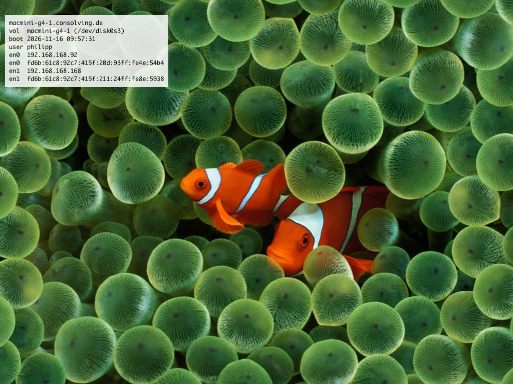

# wallinfo-darwin-ppc

Desktop wallpaper info overlay for Mac OS X 10.5 (PowerPC). A background job
that waits for the network, renders an info box into a **copy** of the
current wallpaper and activates that copy. The original wallpaper file is
never modified.

The box (top-left, below the menu bar) shows: hostname, boot volume name +
device, startup time, logged-in user, and every non-loopback network
interface with its IPv4/IPv6 addresses.



## Build

Cross builds only — needs Apple frameworks, no native Linux build. Requires
osxcross with the macports-legacy ppc targets (`oppc32-gcc` / `oppc64-gcc`),
e.g. on a build box at `/opt/osxcross`.

```sh
make cross32     # -> bin/wallinfo-ppc   (PowerPC G4)
make cross64     # -> bin/wallinfo-ppc64 (G5 only)
make all-cross
./deploy.sh      # scp binaries + wrapper + plist + install.sh to the target
```

No TLS libraries needed (unlike kopia-darwin-ppc).

## Setup

On the target Mac (as root):

```sh
sudo sh install.sh
```

This installs:

| Path | What |
|---|---|
| `/usr/local/libexec/wallinfo-ppc` | ppc32 binary |
| `/usr/local/libexec/wallinfo-ppc64` | ppc64 binary |
| `/usr/local/bin/wallinfo` | arch-picking wrapper (runs ppc64 only if the CPU execs it) |
| `/Library/LaunchAgents/de.consolving.wallinfo.plist` | LaunchAgent, `wallinfo -f`, KeepAlive |

Then load the agent as the console user:

```sh
launchctl load /Library/LaunchAgents/de.consolving.wallinfo.plist
```

The agent renders on login, waits for the network first, and re-renders when
the info (IPs) or the wallpaper changes. State lives in
`~/Library/Application Support/wallinfo/` (`state.txt` with the recorded
original + rendered `wallpaper.<ext>`).

## Usage

```
wallinfo            daemonize: wait for network, update, refresh every 300 s
wallinfo -f         foreground loop (used by the LaunchAgent)
wallinfo -o         one update, then exit
wallinfo -r         restore the recorded original wallpaper, then exit
wallinfo -t SEC     network wait timeout, 0 = forever (default 300)
wallinfo -i SEC     refresh interval (default 300)
wallinfo -V         print version (also used by the wrapper as arch probe)
```

Signals: `TERM`/`INT` exit, `HUP` forces an immediate refresh.

## Layout of the box

White box (alpha 0.85), black Monaco 12 px text, in this order:

```
macmini-g4-1.consolving.de
vol  macmini-g4-1 (/dev/disk0s3)
boot 2026-11-16 09:57:33
user philipp
en0  192.168.168.92
en0  fd00:...
en1  192.168.168.168
en1  fd00:...
```

The box is positioned in the **top-left corner**: top edge 30 px from the
top (22 px menu bar + 8 px inset, `TOP_OFFSET`), left edge 10 px from the
left (`BOX_LEFT_INSET`) — verified by pixel-sampling the rendered wallpaper.

The overlay is rendered at **screen resolution**: the source wallpaper is
scaled to cover the screen (like the Dock's "fill screen" placement) before
the box is drawn. A screen-sized wallpaper is always shown 1:1 by the Dock,
so the box can never be cropped out of view — otherwise a 2560x1600
wallpaper on a 1024x768 screen lost everything but the box's bottom-right
corner.

## How the wallpaper is switched (the tricky part)

The source wallpaper is only ever read. The overlay is rendered into
`~/Library/Application Support/wallinfo/wallpaper-<ts>-<pid>.<ext>` and
activated:

1. **Prefs rewrite** — both dicts of `~/Library/Preferences/com.apple.desktop.plist`
   are rewritten to a clean static state (`Change=false`, `ImageFilePath`,
   and for the Tiger-legacy `Background` dict — the one a 10.4-upgraded
   system's Dock honours — also `NewImageFilePath` + `ImageFileAlias`).
   Rotation leftovers (`ChangePath`, `NewChangePath`, `TimerPopUpTag`) are
   dropped: as long as `ChangePath` survives, the Dock keeps rotating and
   overwrites the entry on every tick.
2. **osascript** — `tell application "System Events" to set picture of every
   desktop to ...` pokes the running Dock so the new picture applies
   immediately. System Events writes exactly the key set from step 1.

Source selection: if the Dock currently shows our own copy, render from the
recorded original (state file) — never from the copy, which would stack
boxes. If the user picked a new wallpaper, that becomes the new original.
If only the legacy `Background` dict exists (`ChangePath` pointing at a
folder of randomly changing pictures), a random image from that folder is
adopted as the original. `wallinfo -r` restores the recorded original.

## Gotchas (all found on the G4, Leopard 10.5.8)

- **ATS/CoreGraphics is not fork-safe.** A forked child that touches fonts
  SIGBUSes in `AssureDBGenerationSynched` (`*** single-threaded process
  forked ***`). `daemonize()` therefore never continues in the child: it
  re-execs itself with `-D` (same loop, syslog logging). The launchd agent
  (`-f`) is exec'd by launchd and is unaffected.
- **The Dock fights direct prefs writes.** While the random-change config
  (`ChangePath` + `TimerPopUpTag`) is present, the Dock rewrites the
  `Background` dict on every rotation tick — a plain `CFPreferencesSetValue`
  is lost. Hence the full rewrite (no rotation keys left) + osascript.
- **getattrlist volume name**: the buffer starts with a `u_int32_t` total
  length, then the `attrreference_t` records; `attr_dataoffset` is relative
  to the `attrreference_t` itself, and `attr_length` includes the NUL.
  Also, `sys/attr.h` does not declare `getattrlist` on the 10.5 SDK.
- **Logging**: `LOG_DAEMON` + `LOG_INFO` is dropped by the stock 10.5
  syslog.conf (`*.notice` rule); daemon mode logs at `LOG_NOTICE`. The
  LaunchAgent logs via launchd's stderr forwarding under its label.

## Debug

- Crash logs: `~/Library/Logs/CrashReporter/wallinfo-ppc_*.crash`
- Agent log: `grep de.consolving.wallinfo /var/log/system.log`
- Daemon log: `grep wallinfo /var/log/system.log`

## Source layout

```
src/wallinfo.c               everything (info collection, render, prefs)
tests/                       debug probes used to reverse-engineer the above
de.consolving.wallinfo.plist LaunchAgent
wallinfo-wrapper             arch picker (ppc64 if runnable, else ppc32)
install.sh                   run on the target Mac as root
deploy.sh                    run on the build box, pushes to the target
docs/wallpaper-example.jpg   rendered example (Clown Fish + info box)
```
